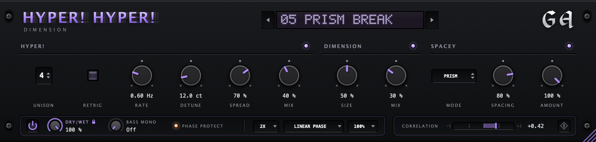
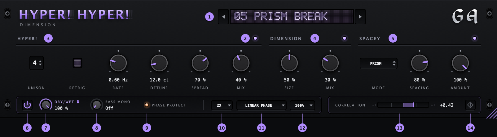
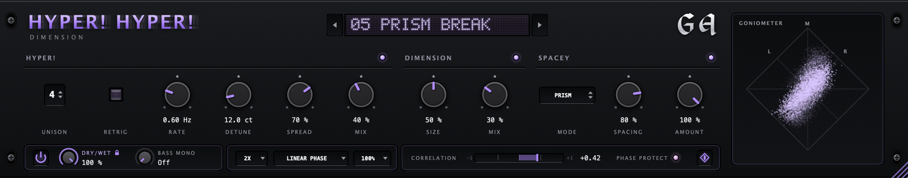

# Hyper! Hyper! Dimension



**Unison, dimension and stereo width in one plug-in, with no loudness bias and a safety net for
mono. Free, and it'll stay that way.**

Hyper! Hyper! Dimension is **inspired by Hyper/Dimension from [Xfer Records](https://xferrecords.com)**,
the effect that makes a thin synth line sound big, and takes the idea a bit further. Three sections
work in a row: **Hyper!** stacks up to 17 detuned unison voices, **Dimension** adds the airy width of a
classic chorus ensemble, and **Spacey** offers six more ways to go wide, from subtle comb filtering to
stereo saturation, drifting frequency shifts and lo-fi crunch.

It's made by a producer, for producers, and it tries to have every feature you'd actually care
about: loudness compensation, an equal-loudness bypass, oversampling with a choice of linear-phase or
low-latency filtering, a resizable interface, and **Phase Protect**, a system that keeps the stereo
image from going into negative correlation, which, quite frankly, is one of the most annoying things
to keep an eye on when you use widening effects.

Interface and sound designed and tested by GA, coded with the help of AI.

**[Get it on the releases page](https://github.com/georgeabyss/GA-hyper-hyper-dimension/releases)**:
Mac (VST3 and AU) and Windows (VST3).

> **Like the original?** Hyper/Dimension is part of Xfer Records' **Serum**. If you can afford it,
> [buy their stuff](https://xferrecords.com): they keep moving sound design forward and deserve the
> support.
>
> **Hyper! Hyper! Dimension is not affiliated with or endorsed by Xfer Records in any way.**

---

## What's in it

- **Up to 17 unison voices** (the original has 7), with Retrig for a little "zap" at the start of
  every note.
- **Six kinds of width** in the Spacey section: comb filtering, stereo saturation, phase smearing,
  frequency shifting, a band-splitting auto-panner and lo-fi crunch. Not all of them are mono-safe on
  their own, and that's fine, because:
- **Phase Protect** (optional, on by default) makes sure your sound doesn't cancel out in mono,
  however wide you go, and shows you when it has to step in.
- **No loudness bias.** Louder tends to sound better, which makes it hard to judge an effect. The
  plug-in compensates loudness changes internally, and the bypass is equal-loudness, so a comparison
  tells you what the effect does, not how loud it is.
- **The practical bits:** 16 presets, lockable Dry/Wet and Bass Mono, oversampling, a correlation
  meter, a goniometer and a resizable window.

---

## The three sections

### HYPER!
Up to 17 copies of your sound, each drifting slightly in pitch, so they beat against each other like
a stack of detuned oscillators.

| | |
|---|---|
| **Unison** | number of voices, 1–17 |
| **Retrig** | every MIDI note restarts the voices in tune, so each note starts tight and then spreads. Needs MIDI routed to the plug-in. |
| **Rate** | how fast the voices drift |
| **Detune** | how far they drift |
| **Spread** | how wide they sit in the stereo field |
| **Mix** | how much of the unison you hear |

### DIMENSION
Short, slowly moving delays on each side, in opposite polarity: the airy width of an old chorus
ensemble. **Size** sets the delay times, **Mix** the amount.

### SPACEY
Pick a mode, shape it with **Spacing** (the centre is each mode's default) and blend it in with
**Amount**.

| Mode | What you hear |
|---|---|
| **Comb** | A clean spread: different comb-filter peaks on each side. The mono sum stays exactly the same. |
| **Twin Drive** | Stereo grit: soft saturation on the left, wave folding on the right. The bass stays clean. |
| **Phase Smear** | A soft, slowly moving width that leaves the tone of each side as it is. |
| **Freq Shift** | A slow swirl: the left side is shifted up, the right side down, by a few hertz. |
| **Prism** | The sound split into eight bands that drift around the stereo field. |
| **Lo-Fi Twins** | A different bit depth and sample rate on each side. The bass stays clean. |

---

## Good to know

- **No loudness bias.** Whatever the effect does to the level is compensated internally, based on
  how loud it sounds rather than on raw level. Bypass switches at equal loudness, without a click.
- **Phase Protect** (on by default). If the stereo image gets so wide that parts of it would cancel in
  mono, Phase Protect pulls the width back a little. Its LED flashes orange when that's audible. Your
  input itself is never changed.
- **Bass Mono** sums everything below the chosen frequency to mono.
- **Locks.** Click the name *Dry/Wet* or *Bass Mono* to lock it (a padlock appears). Locked values
  stay where they are when you switch presets.
- **Safety mute.** On absurd levels or broken audio, the plug-in goes silent straight away, like
  REAPER does. Click the display to resume.
- **Oversampling** (up to 8×) keeps Twin Drive and Lo-Fi Twins free of aliasing. Your DAW compensates
  the small latency it adds.

### Presets
16 factory presets, from subtle to silly, covering every Spacey mode. Your own presets are saved as
single files, so they're easy to pass on.

---

## A tour of the interface

A lot of effort went into the look and feel, so the plug-in behaves the way you'd expect and has the
options you'd want.



1. **Presets.** ◀ ▶ step through them; click the display for the full list, Save, Rename and Delete.
   A star means you've changed something.
2. **Section LEDs.** Switch a section on or off without touching its knobs.
3. **HYPER!**: Unison, Retrig, Rate, Detune, Spread, Mix.
4. **DIMENSION**: Size, Mix.
5. **SPACEY**: Mode, Spacing, Amount.
6. **Bypass**: click-free and equal-loudness.
7. **Dry/Wet** for the whole effect. Click the name to lock it.
8. **Bass Mono.** Click the name to lock it.
9. **Oversampling.**
10. **Anti-alias filter**: Linear Phase (cleanest) or Low Latency.
11. **Window size**, 75–200 %, or drag the bottom right corner.
12. **Correlation meter.** +1 is mono, 0 is very wide, below 0 (red) cancels in mono.
13. **Phase Protect** on / off. The LED flashes orange while it's working.
14. **Goniometer.** Opens a stereo scope next to the meter:



**Tips:** drag knobs up and down (hold Shift for fine moves), double-click to reset, scroll for small
steps, and right-click to type a value or reach your DAW's automation and MIDI-learn options.

---

## Installing

Grab the zip for your system from the [releases page](https://github.com/georgeabyss/GA-hyper-hyper-dimension/releases).

**macOS 11 or newer** (`…-macOS.zip`): unzip it and follow **READ ME FIRST.txt**. macOS asks you to
allow the installer once, because it isn't signed with a paid Apple certificate. Then choose VST3
and/or Audio Unit. In Logic you'll find it under Audio Units → GA.

**Windows 10 or 11** (`…-Windows-VST3.zip`): unzip it and copy `Hyper! Hyper! Dimension.vst3` to
`C:\Program Files\Common Files\VST3`, then rescan your plug-ins. The Windows version is brand new, so
feedback is very welcome.

To uninstall, delete the plug-in files again (on the Mac from `/Library/Audio/Plug-Ins/VST3` and
`/Library/Audio/Plug-Ins/Components`). See what's new in each version in the [changelog](CHANGELOG.md).

---

## For developers

Built with [JUCE](https://juce.com) 9 and CMake. On a Mac, with the Xcode command line tools, Ninja and
JUCE in `~/Downloads/JUCE` (or pass `-DJUCE_DIR=...`):

```sh
cmake -B build -G Ninja -DCMAKE_BUILD_TYPE=Release && cmake --build build
./install.sh                  # install the plug-ins locally (asks for your password)
./make_installer.sh           # dist/HyperHyperDimension-<version>-macOS.zip
./tools/make_screenshots.sh   # re-render the images in docs/ from the real interface
```

The Windows build runs on GitHub Actions (`.github/workflows/build.yml`) and is attached to every
published release automatically; for an existing release, run the workflow by hand with its tag.
The version number lives in `CMakeLists.txt`.

| Source | |
|---|---|
| `HyperDimEngine.*`, `DspBlocks.h` | the sound, independent of JUCE |
| `PluginProcessor.*`, `ParamIDs.h` | parameters, oversampling, bypass, safety mute |
| `PresetManager.*` | presets and locks |
| `MainPanel.*`, `PresetBar.*`, `Controls.*`, `Meters.*`, `UiStyle.*`, `PluginEditor.*` | the interface |

---

## Credits

- Inspired by **Hyper/Dimension** from [Xfer Records](https://xferrecords.com). This is an independent,
  free project, not affiliated with or endorsed by Xfer Records in any way. If you enjoy it, consider
  supporting them by buying Serum.
- Idea, interface design, sound design decisions and testing: GA. Code and factory presets made with
  Claude (AI by Anthropic).
- Built with [JUCE](https://juce.com).
